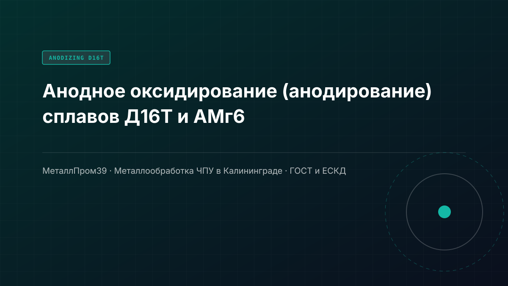

Фрезерованные детали из деформируемых алюминиевых сплавов (**Д16Т, АМг6, В95**) после механической обработки на станках с ЧПУ обладают высокой геометрической точностью, но подвержены межкристаллитной коррозии и имеют невысокую твердость поверхности. Для защиты изделий применяется электрохимическое **анодное оксидирование (анодирование)** по **ГОСТ 9.301-86**.

---

## 1. Виды анодных покрытий

1. **Сернокислое декоративное анодирование (Ан.Окс):** Толщина пленки $10\dots15$ мкм. Защищает от окисления, обеспечивает равномерный матовый сатинированный оттенок или окрашивается в черный, синий, золотистый цвет.
2. **Твердое глубокое анодирование (Ан.Окс.тв):** Проводится в охлажденном электролите (до -5 °C). Толщина оксидного слоя достигает $30\dots50$ мкм, а микротвердость превышает 400 HV (сравнима с закаленной сталью). Применяется для направляющих, поршней и корпусов приборов.

---

## 2. Учет изменения размеров детали при анодировании

При проектировании посадочных отверстий под подшипники по квалитету **IT7** конструктор обязан учитывать приращение размера:
* При толщине пленки 30 мкм: примерно 50% слоя растет внутрь металла, а 50% — наружу.
* Диаметр наружного вала увеличивается на $pprox 30$ мкм, а диаметр отверстия уменьшается на ту же величину.

---

## 3. Видео: процесс анодного оксидирования

  
▶ ВИДЕОМАТЕРИАЛЫ RUTUBE:

  <a href="https://rutube.ru/search/?query=анодирование+алюминия+своими+руками+производство" target="_blank" rel="noopener noreferrer" class="text-sm text-[var(--color-ink)] hover:text-[var(--color-accent)] underline">
    Смотреть процесс химической подготовки и анодирования алюминия на RuTube →
  </a>

Технологические нюансы фрезерования алюминиевых сплавов читайте в материале [«Фрезерная ЧПУ обработка деталей из алюминия Д16Т и АМг6»](/stati/frezernaya-obrabotka-alyuminiya-d16t-chpu/).

