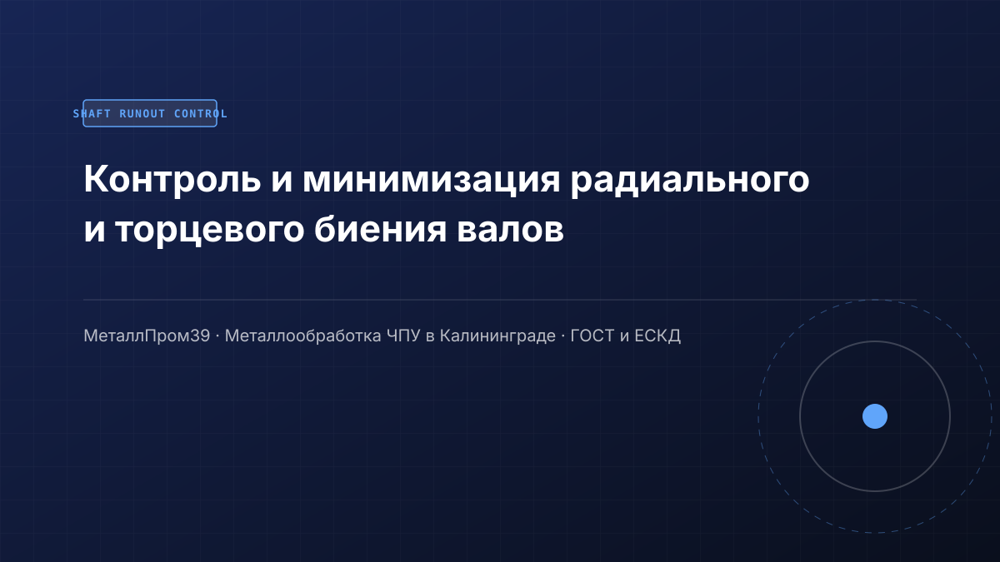

Радиальное биение шеек валов под подшипники приводит к преждевременному разрушению опор качения, вибрациям роторов электродвигателей и ускоренному износу сальниковых уплотнений. Допуск радиального биения для скоростных ступенчатых валов составляет **0,01–0,015 мм**.

---

## 1. Основные причины биения заготовки

1. **Погрешность базирования в патроне:** Зажатие в некалиброванные сырые кулачки приводит к перекосу оси заготовки.
2. **Отжим детали силами резания:** При отношении длины к диаметру $L/D > 5$ вал прогибается под действием радиальной силы резания $P_y$.
3. **Несоосность центровых гнезд:** Некачественное центрование сверлом по **ГОСТ 14034-74**.

---

## 2. Методы обеспечения биения менее 0,015 мм

* **Чистовая обработка в жестких центрах:** Деталь базируется между поводковым патроном и прецизионным вращающимся упорным центром задней бабки. Все шейки вала протачиваются с одного установа.
* **Использование люнетов:** Для длинных валов ($L > 400$ мм) применяется подвижный или неподвижный люнет, поддерживающий шейку вала.
* **Расточка кулачков «по месту»:** Мягкие кулачки патрона протачиваются непосредственно на станке под диаметр конкретной партии заготовок.

---

## 3. Видео: замер биения вала индикатором

  
▶ ВИДЕОМАТЕРИАЛЫ RUTUBE:

  <a href="https://rutube.ru/search/?query=проверка+радиального+биения+вала" target="_blank" rel="noopener noreferrer" class="text-sm text-[var(--color-ink)] hover:text-[var(--color-accent)] underline">
    Смотреть видео проверки биения валов на призмах индикатором часового типа на RuTube →
  </a>

Ознакомиться с регламентом приемки валов можно в статье [«Изготовление валов и втулок на ЧПУ по чертежам»](/stati/izgotovlenie-valov-i-vtulok-chpu-po-chertezham/).

