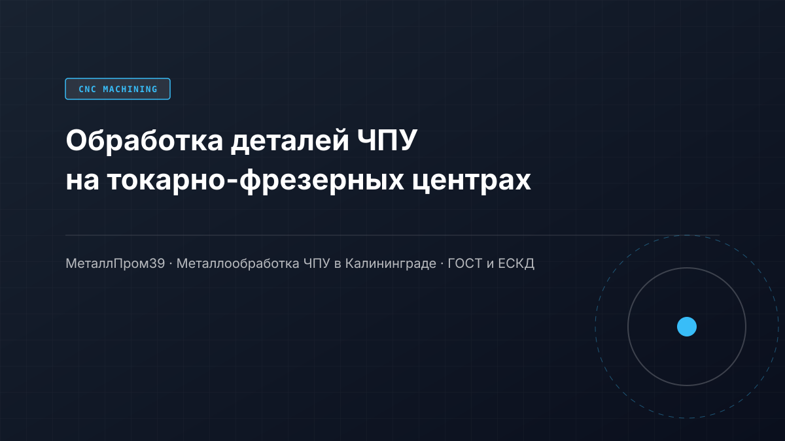

Контрактное изготовление прецизионных деталей на станках с числовым программным управлением (ЧПУ) является основой современного машиностроения, приборостроения и судоремонта. В отличие от ручной универсальной обработки, современные токарные и фрезерные обрабатывающие центры обеспечивают повторяемость размеров в пределах допуска **IT7** без накопления размерной погрешности.

---

## 1. Технологический цикл изготовления партии деталей

Производство изделий по чертежам заказчика на мощностях цеха МеталлПром39 строится по строго регламентированному маршруту:

1. **Входной контроль КД и DFM-экспертиза:** Технологи проверяют чертежи по [ЕСКД и 3D-модели в формате STEP](/stati/trebovaniya-k-chertezham-i-3d-modelyam-dlya-chpu/) на отсутствие нетехнологичных радиусов и недоступных зон.
2. **Разработка управляющих программ (CAM):** Построение траекторий инструмента с адаптивным фрезерованием и оптимизацией съема стружки.
3. **Заготовительный раскрой:** Резка калиброванного проката на ленточнопильных станках с минимальным припуском на торцевание.
4. **Механическая обработка:** [Токарные работы с ЧПУ](/tokarnye-raboty-chpu/) и [3-осевое фрезерование](/frezernye-raboty-chpu/) с постоянной подачей смазочно-охлаждающей жидкости (СОЖ).
5. **Метрологический контроль ОТК:** Измерение шеек валов, межцентровых расстояний и шероховатости по [квалитетам IT7–IT12 по ГОСТ 25346](/stati/kvalitety-tochnosti-i-sherohovatost-gost/).

---

## 2. Видеообзор: процесс металлообработки на ЧПУ

Для наглядного ознакомления с динамикой резания и стружкообразования рекомендуем посмотреть демонстрационные материалы:

  
▶ ВИДЕОМАТЕРИАЛЫ RUTUBE:

  <a href="https://rutube.ru/search/?query=изготовление+деталей+чпу" target="_blank" rel="noopener noreferrer" class="text-sm text-[var(--color-ink)] hover:text-[var(--color-accent)] underline">
    Смотреть технологические видео процесса изготовления деталей на ЧПУ на RuTube →
  </a>

---

## 3. Расчет стоимости партии

Стоимость нормо-часа оборудования цеха начинается от **2 500 ₽/н-час** на токарных центрах и от **3 000 ₽/н-час** на фрезерных с учетом НДС 22%. Вы можете рассчитать бюджет изготовления партии с учетом объема заготовки и тиража в нашем [онлайн-калькуляторе стоимости ЧПУ](/kalkulyator-stoimosti-chpu/).

