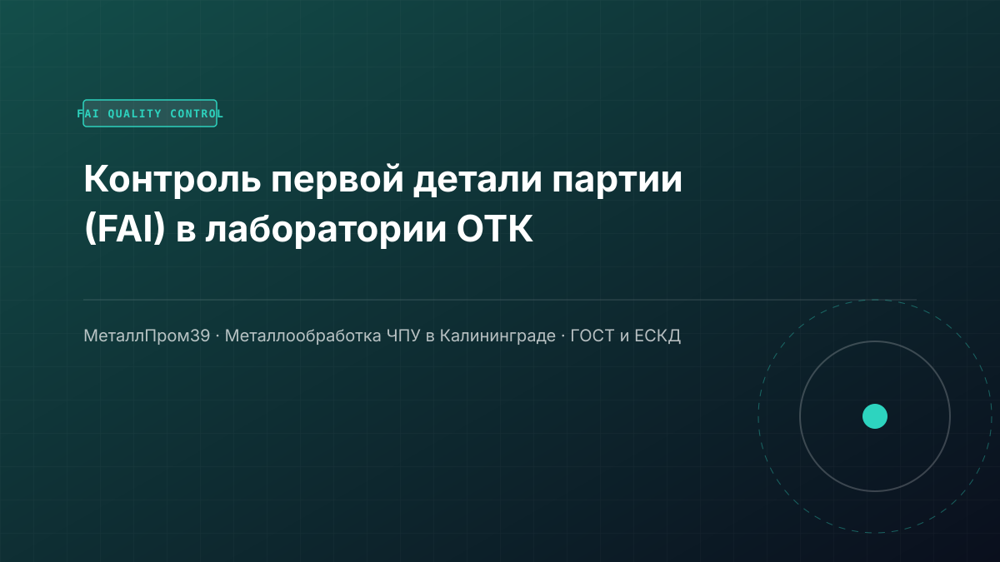

В серийном контрактном производстве металлообработки критически важно выявить любые несоответствия геометрии до того, как станок начнет обрабатывать весь массив заготовок. Для этого применяется международный регламент **First Article Inspection (FAI) — контроль первой детали партии**.

---

## 1. Этапы процедуры FAI

После завершения наладки станка и отработки управляющей программы оператор передает первое готовое изделие в лабораторию ОТК:
1. **Проверка 100% размеров по чертежу:** Замеряются не только сопрягаемые шейки, но и свободные межосевые расстояния, фаски и резьбы.
2. **Контроль шероховатости:** Проверка профилометром базовых плоскостей на соответствие требованиям $Ra\,1.25\dots2.5$.
3. **Контроль геометрических допусков (ГОСТ 2.308):** Измерение плоскостности, соосности и радиального биения.
4. **Оформление карты FAI:** Технолог вносит коррекцию на износ инструмента в стойку ЧПУ при малейшем смещении размера к границе допуска.

Только после подписи начальника ОТК в сменном задании оператор получает разрешение на непрерывную обработку партии.

---

## 2. Видео: работа контролера ОТК в цехе

  
▶ ВИДЕОМАТЕРИАЛЫ RUTUBE:

  <a href="https://rutube.ru/search/?query=контроль+деталей+отк+измерения" target="_blank" rel="noopener noreferrer" class="text-sm text-[var(--color-ink)] hover:text-[var(--color-accent)] underline">
    Смотреть видео метрологических измерений и контроля геометрии деталей на RuTube →
  </a>

Подробнее об измерительном оснащении цеха читайте в разделе [«Контроль качества и оборудование»](/kontrol-kachestva-i-oborudovanie/).

