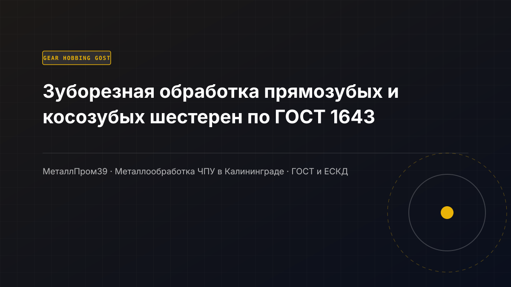

Зубчатые передачи редукторов, крановых лебедок и станков работают в условиях высоких циклических контактных напряжений. Точность профиля зуба определяет шумность, плавность зацепления и долговечность редуктора в соответствии со степенями точности по **ГОСТ 1643-81**.

---

## 1. Технологический маршрут изготовления шестерни

1. **Токарная обработка заготовки:** Получение базового диска или вал-шестерни с высокой соосностью посадочного отверстия и наружного венца (радиальное биение не более 0,01 мм).
2. **Зубонарезание методом обкатки:** Нарезание впадин червячными фрезами модулей $m = 1.0\dots6.0$ мм.
3. **Термообработка:** [Закалка ТВЧ зубчатого венца](/stati/termicheskaya-obrabotka-staley-posle-chpu-zakalka-tvc/) до твердости 48–54 HRC для предотвращения выкрашивания рабочей поверхности.
4. **Финишное зубошлифование:** Снятие припуска $0,15\dots0,25$ мм профильным кругом для устранения термических поводок и достижения **7-й степени точности по ГОСТ 1643**.

---

## 2. Видео: зубофрезерование шестерни методом обкатки

  
▶ ВИДЕОМАТЕРИАЛЫ RUTUBE:

  <a href="https://rutube.ru/search/?query=зубофрезерный+станок+нарезка+шестерни" target="_blank" rel="noopener noreferrer" class="text-sm text-[var(--color-ink)] hover:text-[var(--color-accent)] underline">
    Смотреть видео нарезания зубьев червячной фрезой на RuTube →
  </a>

Подробнее о мощностях участка читайте в разделе [«Зуборезные и шлифовальные работы»](/zuboreznye-i-shlifovalnye-raboty/).

