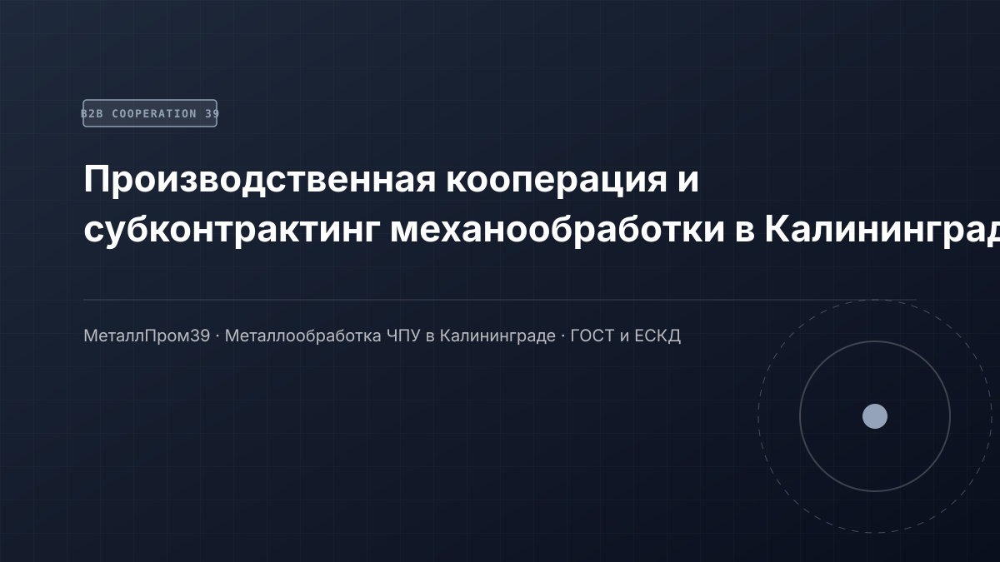

В условиях высокой загрузки машиностроительных производств покупка новых обрабатывающих центров требует месяцев поставки и миллионов рублей капитальных затрат. Оптимальным решением для выполнения срочных госконтрактов и коммерческих заказов является **производственная субконтрактация (кооперация)**.

---

## 1. Преимущества кооперации с МеталлПром39

* **Двухсменный график работы:** Позволяет оперативно изготавливать срочные серии деталей без срыва графиков сборки.
* **Работа с давальческим сырьем:** Заказчик может предоставить собственный металлопрокат с заводскими сертификатами, оплачивая исключительно машинное время.
* **Безналичный расчет с НДС 22% / УСН:** Полный комплект закрывающих документов (УПД, счета-фактуры, паспорта качества ОТК).
* **Юридическая защита коммерческой тайны (NDA):** Защита чертежей и 3D-моделей в соответствии с ФЗ № 98 «О коммерческой тайне».

---

## 2. Логистика по Калининградской области

Благодаря компактности региона готовая продукция доставляется автотранспортом до цеха заказчика в Калининграде, Светлом, Балтийске, Черняховске и Гурьевске в течение 2–4 часов с момента финишной приемки ОТК.

---

## 3. Видео: организация современного цеха механообработки

  
▶ ВИДЕОМАТЕРИАЛЫ RUTUBE:

  <a href="https://rutube.ru/search/?query=производство+металлообработка+цех" target="_blank" rel="noopener noreferrer" class="text-sm text-[var(--color-ink)] hover:text-[var(--color-accent)] underline">
    Смотреть обзор организации рабочего процесса на современных участках ЧПУ на RuTube →
  </a>

Связаться с диспетчером и узнать текущую загрузку станочного парка можно на странице [«Контакты»](/kontakty/).

