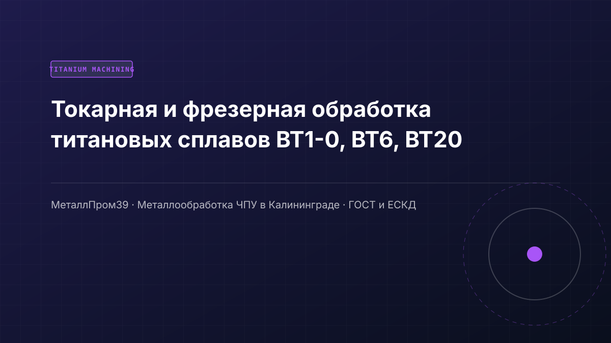

Титановые сплавы (**ВТ1-0, ВТ6, ВТ20**) сочетают непревзойденную коррозионную стойкость в морской воде с высокой удельной прочностью. Однако низкий модуль упругости и чрезвычайно низкая теплопроводность делают титан одним из самых сложных материалов для металлообработки на станках с ЧПУ.

---

## 1. Главные трудности резания титана

1. **Тепловой удар по кромке инструмента:** До 80% тепла при резании концентрируется непосредственно на режущей кромке пластины (в отличие от стали, где тепло уходит в стружку).
2. **Наклеп и наростообразование:** Титан химически активен при температуре свыше 500 °C и диффундирует в твердый сплав.
3. **Упругий отжим детали:** Низкий модуль упругости ($E pprox 110$ ГПа против 210 ГПа у стали) вызывает отжим тонких стенок при фрезеровании.

---

## 2. Рекомендации технологов МеталлПром39

* **Скорость резания:** Умеренная, $V_c = 40\dots70$ м/мин для фрезерования монолитными твердосплавными фрезами с покрытием AlTiN / TiAlN.
* **Подача СОЖ:** Обязательная подача водосмешиваемой СОЖ под давлением непосредственно в зону стружкообразования.
* **Жесткость СПИД:** Применение термозажимных и гидропластовых патронов для полного гашения микровибраций.

---

## 3. Видео: фрезерование титана

  
▶ ВИДЕОМАТЕРИАЛЫ RUTUBE:

  <a href="https://rutube.ru/search/?query=фрезерование+титана+чпу" target="_blank" rel="noopener noreferrer" class="text-sm text-[var(--color-ink)] hover:text-[var(--color-accent)] underline">
    Смотреть видео обработки титановых корпусов на фрезерных ЧПУ на RuTube →
  </a>

Сравнить свойства титана со сталями можно в руководстве [«Выбор конструкционных сталей для ЧПУ обработки»](/stati/vybor-stali-dlya-chpu-obrabotki/).

